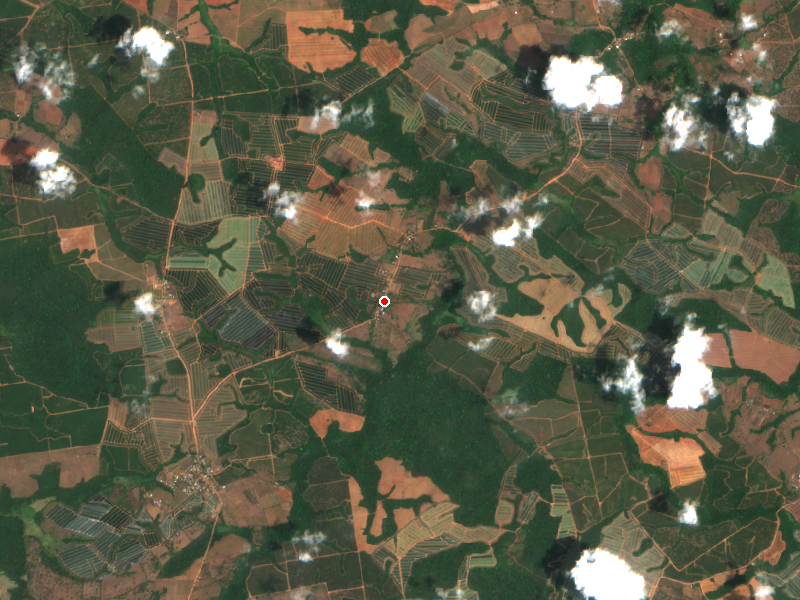
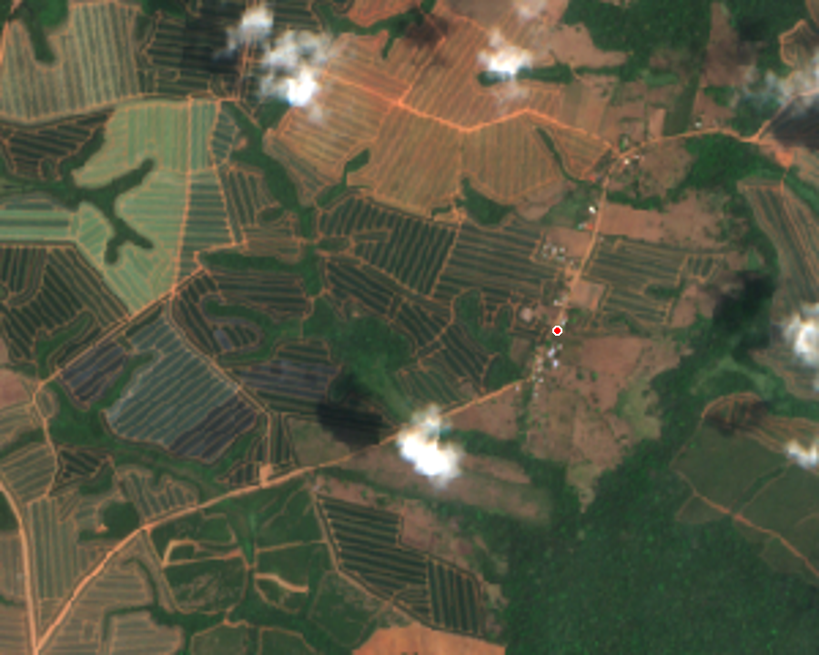
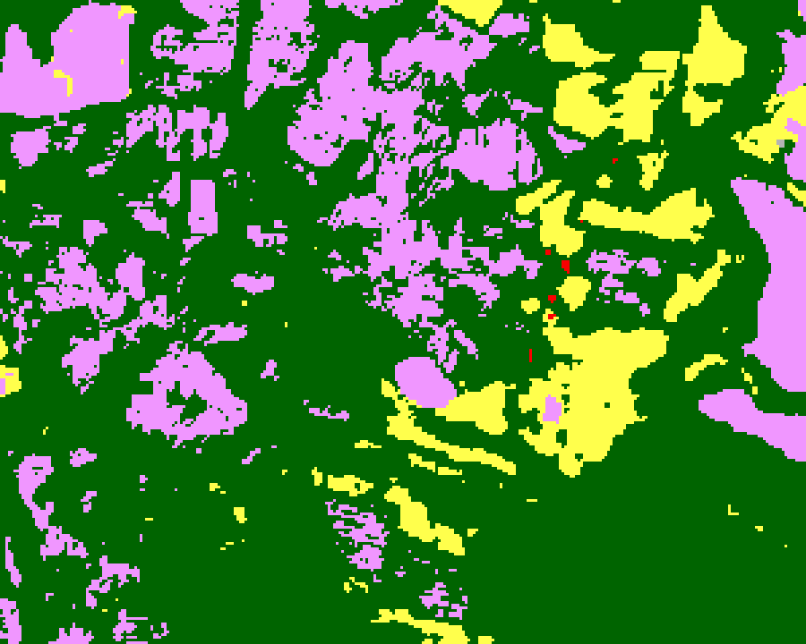
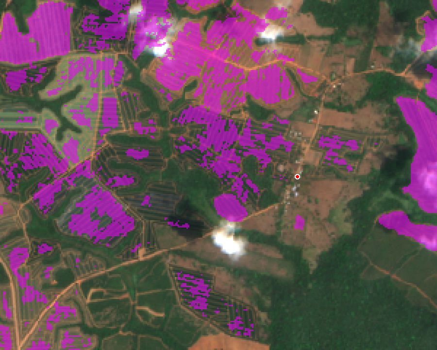
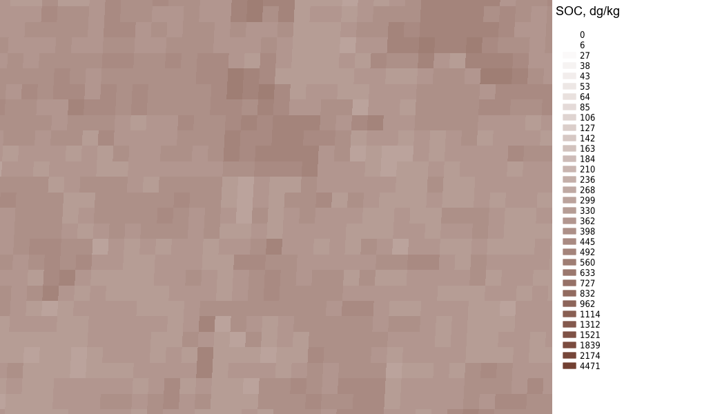
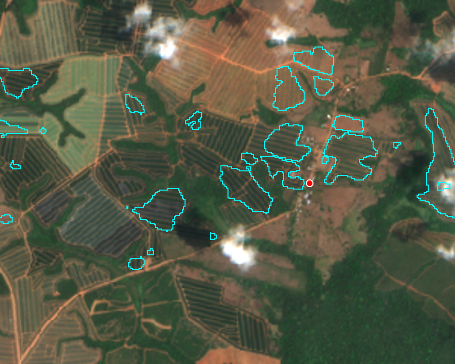

# San Carlos: a visual starting point, not a surveyed farm

**Selected research/demo example: latitude 10.999930, longitude -84.601590, Costa Rica.**
Use these images to help a farmer recognize an area and understand the evidence before comparing
rotations. They do not identify the owner, exact parcel, current crop, pineapple, or current soil
condition. This documentation records the 14 November 2026 research baseline; it adds no map UI,
backend integration or scoring changes.

## Quick reading path

1. Look at the Sentinel-2 overview and detail: recognizable patterns, historical date, some clouds.
2. Compare land cover, modeled soil and predicted boundaries as **different types of evidence**.
3. Read the [next steps](#next-steps) before using this example in a recommendation demo.

## Location and research history

Coordinates use WGS84 (EPSG:4326). Bounding boxes are **west, south, east, north**:

| Extent | Bounds | Meaning |
|---|---|---|
| Overview | `[-84.64, 10.97, -84.56, 11.03]` | Rectangular research area, not a farm |
| Detail / FTW search | `[-84.622, 10.988, -84.592, 11.012]` | Smaller visual comparison, not a parcel |
| Backend configured region | `[-86.0, 8.0, -82.5, 11.3]` | Request validation scope; still named `TBD (placeholder: Costa Rica)` |

Earlier work screened Santa Cecilia, Guanacaste, and compared clearer imagery with WorldCover.
That was exploratory candidate selection, not a second approved pilot or ground truth. The selected
example here is San Carlos. Visually regular fields and a cropland classification improve the
illustration, but neither establishes crop species. Do not label the site a pineapple farm.

## Six images and how to read them

### 1. Historical Sentinel-2 overview

Contains modified Copernicus Sentinel data 2024. Scene `S2B_16PGT_20240325_0_L2A`,
true-color Level-2A, native visible bands 10 m; rendered via public AWS COG/TiTiler.
The red marker approximates the reference point. Clouds and shadows remain.
[Original TCI GeoTIFF](https://sentinel-cogs.s3.us-west-2.amazonaws.com/sentinel-s2-l2a-cogs/16/P/GT/2024/3/S2B_16PGT_20240325_0_L2A/TCI.tif)
and [STAC scene](https://earth-search.aws.element84.com/v1/collections/sentinel-2-l2a/items/S2B_16PGT_20240325_0_L2A).

Ten downloaded candidates were compared, not the complete archive. In the overview output grid,
SCL classes 8/9/10 occupied 2.66% and class 3 (shadow) 4.93% of 480,000 valid resampled pixels.
SCL is a classification, not perfect cloud detection; these are local output-grid statistics, not
scene-wide metadata. The clearest inspected image need not be the newest or show present conditions.

### 2. Detail for recognizing the area

Contains modified Copernicus Sentinel data 2024; same scene and source as image 1.
The 300 × 240 pixel crop was enlarged to 900 × 720: **enlargement adds no spatial detail**.
These are north-up display PNGs on a latitude/longitude grid, not georeferenced analytical rasters.
Roads, apparent planting rows and vegetation patterns do not prove surveyed boundaries or crop identity.

### 3. ESA WorldCover: land cover, not soil or crop species

Purple is class **40 (cropland)**; dark green is tree cover, yellow grassland, red built-up.
WorldCover 2021 v200 has approximately 10 m source pixels. It is **not NASA**, not a pineapple map,
and not a soil map. It incorporates Sentinel data, so agreement with Sentinel imagery is not fully
independent confirmation. The 2021 map and 2024 photograph describe different times.

© ESA WorldCover project 2021 / Contains modified Copernicus Sentinel data (2021) processed by
ESA WorldCover consortium. Cropped/enlarged for this project.
[Dataset citation: Zanaga et al., 2022](https://doi.org/10.5281/zenodo.7254221),
[source tile](https://esa-worldcover.s3.eu-central-1.amazonaws.com/v200/2021/map/ESA_WorldCover_10m_2021_v200_N09W087_Map.tif),
[product manual](https://esa-worldcover.s3.eu-central-1.amazonaws.com/v200/2021/docs/WorldCover_PUM_V2.0.pdf).

Research counted class-40 colors in rendered grids: 12.01% of the overview and 20.89% of the detail.
Those are output-pixel proportions, **not surveyed land area**, local classification accuracy or a
statement about the exact reference point. Classification errors and omitted cultivated-looking
areas remain possible.

### WorldCover overlay on the satellite image

Pink marks the 2021 cropland classification, not field boundaries or crop identity; the image
is from 2024. Contains modified Copernicus Sentinel data and ESA WorldCover data.

### 4. ISRIC SoilGrids: modeled organic carbon

ISRIC SoilGrids 2.0, predicted mean soil organic carbon (SOC), **0–5 cm**, approximately **250 m**
source resolution. The original legend is **dg/kg**: divide by 10 for g/kg. The overview extent
was rendered through WMS layer `soc_0-5cm_mean`; the legend was placed alongside it.
Credit: ISRIC — World Soil Information; [SoilGrids 2.0 paper, Poggio et al.](https://doi.org/10.5194/soil-7-217-2021),
[product documentation](https://docs.isric.org/globaldata/soilgrids/),
[WMS source](https://maps.isric.org/mapserv?map=/map/soc.map).

This is a machine-learning prediction based on observations of different dates, not a current field
sample, suitability score or measured soil-health improvement. The mean image does not display the
prediction uncertainty. SOC does **not** supply the pH and moisture used by the backend; those remain
mock values in every data mode. SoilGrids is complementary, **not NASA**.
The [provider page](https://isric.org/explore/soilgrids/) currently warns that its REST API is paused;
the research used WMS, not proof of a reliable future REST integration.

### 5. Fields of the World: incomplete predicted boundaries

Credit: Fields of the World Global, Taylor Geospatial Institute and collaborators, CC BY 4.0;
extracted polygons and overlay created for this research. Contains modified Copernicus Sentinel data
2024 in the background. [Catalog and attribution](https://data.source.coop/ftw/global-data/catalog.json),
[country metadata](https://data.source.coop/ftw/global-data/predictions/vectors/alpha/results-by-admin-conf/admin:country_code=CR/Costa_Rica.json).

FTW Global uses PRUE satellite segmentation at 10 m. Its **alpha** Costa Rica partition has separate
2024 and 2025 predictions. Searching the detail bbox yielded **2 polygons in 2024 and 24 in 2025**;
**none covers the reference point**. Approximate nearest distances were 803 m and 31 m respectively
(full geometries, EPSG:32616). Coverage visibly misses apparent fields and includes fragments.
The 2025 outlines over a 2024 image are diagnostic only: date mismatch, clouds and registration
limit comparison. These are not cadastral parcels, ownership, crop labels or locally validated truth.

Confidence describes modeled reliability sampled from a 500 m grid, not the probability that a
particular outline is correct. Null means unavailable confidence; the suggested ≥69 filter is not
local validation. Do not auto-select a farm from this layer or interpret missing polygons as no farming.

## NASA contribution and the current API boundary

NASA POWER is the **implemented NASA climate source**, separate from the external images above.
The [NASA data-service documentation](https://power.larc.nasa.gov/docs/services/) and
[local source notes](../../backend/docs/sources/nasa_power.md) describe MERRA-2 meteorology at roughly
0.5° × 0.625° (about 55 × 70 km here). Many nearby fields share climate values: the point endpoint
does not measure weather at a farm or compute an average inside the selected rectangle.
The saved climatology fixture reports **January 2001–December 2025**, not a recent forecast;
confirm the returned period when fetching the selected pilot point.

Source inspection at `1992e21` on 14 November 2026 found:

| Available now | Important boundary |
|---|---|
| Monthly POWER normals in `live`/`cached`; mock climate by default | Recommendation services still use monthly climatology, not a forecast |
| Daily `daily_weather()` DataFrame: date, mean temperature °C, daily rainfall mm | Adapter exists, but is not wired into conditions/ranking; no implemented daily extreme counts |
| Configured temperature, rainfall, soil pH/moisture, heat/frost | Monthly mean maxima/minima are not heat-wave/frost-day counts; soil remains mock |
| Optional farmer `current_rotation`, score delta, benefits/risks/evidence/gaps | The farmer must provide current practice; score differences are not measured water/yield/profit gains |
| Point `lat`/`lon` request; two-decimal POWER request/cache coordinates | No polygon input, crop delineation, image-derived scoring or polygon average |

See [services](../../backend/app/services.py), [source registry](../../backend/app/integrations/__init__.py),
[POWER adapter](../../backend/app/integrations/nasa_power.py), [contract](../../backend/docs/api-contract.yaml)
and [configuration](../../backend/config/mvp.yaml). Existing generated examples use **Alajuela
(10.0, -84.2)**, not this San Carlos point. No fresh live pilot call or runtime check was performed here.

## Desired farmer flow and next steps

The user favors **map → recognizable example → rectangle selection → inspect evidence → priorities
and optional current practice → explained comparison**. This is a direction to design, not an implemented UI.
Keep a plain-language label on every layer: provider, date/period, native resolution, measured vs
modeled vs mocked, coverage and uncertainty. Do not label external map layers as NASA products.
If a rectangle is represented by a point for the current API, show that point explicitly and agree
on its selection rule; do not silently claim area-wide analysis.

The flow has **two entry paths**: a farmer without a current crop can inspect evidence and compare
supported candidates without a baseline; a farmer supplying existing crops should receive relevant
data/recommendations and an alternative only if evidence and crop-cycle logic justify it. Never
invent a current crop or alternative to complete the demo. `crops` selects candidates; omission uses
the configured set. Optional `current_rotation` accepts supported IDs, one per configured season;
it is not a generic single-current-crop field. Other crop-cycle models or new fields need contract-first
agreement. See [entry paths and limitations](../../PROJECT_CONTEXT.md#two-entry-paths-one-evidence-standard).

**Pineapple at San Carlos is one hypothetical farmer report**, not the only scenario the product
should address, an image-derived crop identification or a currently validated recommendation case.
The configured rice/beans/maize candidates and unverified traits do not justify naming a replacement
for pineapple. If evidence is insufficient, show the gap and defer the recommendation.

1. **Use a hypothetical case for the hackathon:** no farmer or real farm is available to validate the
   boundary, current crops/rotation, irrigation or priorities. Label assumptions and seek expert validation later.
2. **Validate model fit:** configured crops are rice, beans and maize, not pineapple. Check traits,
   crop cycle lengths and the local calendar before adding crops or changing config. Primera
   (May–August), postrera (September–November) and dry-season fallow need regional validation here.
3. **Agree on the frontend handoff:** rectangle plus clearly labeled representative point for the
   existing API, or a separately agreed contract change. Reuse the existing baseline comparison.
4. **Prepare honest cached evidence:** reuse suitable saved data first; acquire only agreed missing
   pilot-point requests with explicit live configuration/authorization and a checked budget, then use
   `cached` for the demo. Label provider, observation period, retrieval date, resolution and stale/missing
   data. A miss or empty cache must not silently enable live calls or mock substitution. Keep soil
   mocked and labeled until a real strategy is chosen and documented. See the
   [cache policy and quota boundary](../../PROJECT_CONTEXT.md#cache-first-direction-and-quota-boundaries):
   current `live` fetches first, freshness/quota controls are proposed, and the 50/24h free limit
   concerns OpenTopography Point Elevation identified in unmerged PR #66, not NASA POWER.
5. **Verify before presenting:** check response/contract agreement and map labels, then rehearse
   cached/offline behavior. Present rankings as decision support, not an agronomic prescription.

These actions are pending, not assignments or approval for new integrations. Technical decisions
and any later config/contract changes belong in the [decision log](../../backend/docs/decisions.md).

## Attribution, redistribution and reproducibility

Source and license pages checked on **14 November 2026**:

| Copied assets | Redistribution basis |
|---|---|
| Sentinel overview/detail and Sentinel background in FTW overlay | [Copernicus Sentinel legal notice](https://ewds.climate.copernicus.eu/licences/ec-sentinel): reproduction/adaptation/distribution with source and modification notice |
| WorldCover | [Provider usage and attribution](https://esa-worldcover.org/en/data-access), [CC BY 4.0](https://creativecommons.org/licenses/by/4.0/) |
| SoilGrids map and legend | [ISRIC product/license page](https://isric.org/explore/soilgrids/), CC BY 4.0 |
| FTW polygon overlay | [FTW catalog](https://data.source.coop/ftw/global-data/catalog.json), CC BY 4.0, plus Sentinel background terms |

These six PNGs are unchanged copies of existing research outputs, with descriptive filenames.
Only the derivative displays are bundled: no raw scenes, national Parquet, environments or downloaded
dependencies. Original local research remains under `research/farm-baseline/` (not part of this
documentation bundle); the public source links above remain usable without that folder.

For exact research provenance: `san-carlos/README.md`, `analysis.json`, `make_outputs.py` and
`ftw/README.md`, `summary.json`, `extract.py` describe rendering and extraction in that local folder.
The FTW source object was 126,338,247 bytes, SHA-256
`dc8b88657ce5ed0f71246543f434124a2c804fc698cee408348e2bee2bd39398`, retrieved anonymously on
14 November 2026; all 13 Parquet row groups and both years were examined using bbox then exact
intersection. Outputs preserve full, unclipped geometries. No independent field survey, image
georegistration accuracy check, local model validation or agronomic outcome validation was performed.
